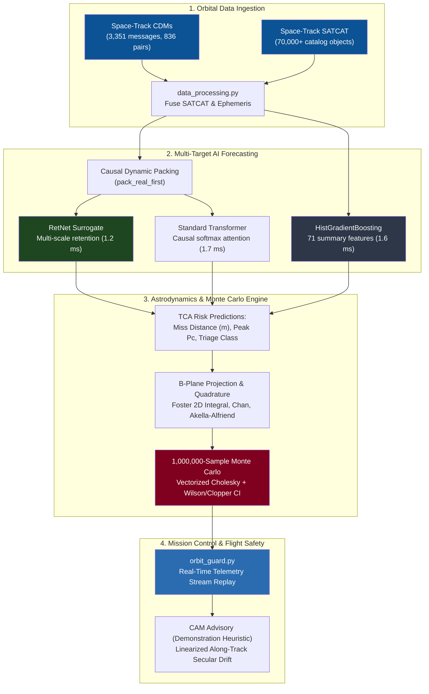

# AI-Powered Satellite Conjunction Assessment & Collision Prediction System

[](https://www.python.org/)
[](https://pytorch.org/)
[](#automated-testing--validation)
[](LICENSE)
[](https://www.space-track.org/)

An operational flight dynamics and machine learning research platform for satellite conjunction assessment (CA), automated collision risk triage screening, and B-plane Monte Carlo astrodynamics simulation.

---

## Table of Contents

- [Overview & Architecture](#overview--architecture)
- [Key Capabilities](#key-capabilities)
- [Verified Benchmark Results](#verified-benchmark-results)
- [Grouped Cross-Validation & Leakage Audit](#grouped-cross-validation--leakage-audit)
- [Installation & Setup](#installation--setup)
- [Interactive Mission-Control CLI (`orbit_guard.py`)](#interactive-mission-control-cli-orbit_guardpy)
- [End-to-End Reproducibility (`reproduce_all.py`)](#end-to-end-reproducibility-reproduce_allpy)
- [Automated Testing & Validation](#automated-testing--validation)
- [Scientific Boundaries & Operational Disclaimers](#scientific-boundaries--operational-disclaimers)
- [Project Repository Structure](#project-repository-structure)
- [License & References](#license--references)

---

## Overview & Architecture

With over 36,000 trackable resident space objects in Low Earth Orbit (LEO) and commercial mega-constellations launching thousands of satellites, satellite operators face an escalating volume of daily Conjunction Data Messages (CDMs). Operational safety workflows rely on high-fidelity numerical orbit propagation and Monte Carlo covariance sampling to estimate collision probability ($P_c$), an approach computationally intractable for catalog-wide real-time screening.

This repository implements a multi-tier triage screening and astrodynamic simulation system:
1. **Multi-Horizon AI Forecaster:** Sequences of CDMs are processed by deep sequence models (RetNet, Transformer) and tabular gradient boosting (HistGB) to predict final miss distance, peak $P_c$, and safety risk category at TCA in under 2 milliseconds.
2. **Astrodynamics B-Plane Engine:** Evaluates 2D planar conjunction geometry, Foster (1992) Gauss-Legendre polar quadrature, Chan (1997) equal-area series, Akella-Alfriend (2000) Laplacian expansions, and vectorized 1,000,000-sample Monte Carlo simulations with exact 95% Wilson and Clopper-Pearson confidence intervals.
3. **Orbit-Guard Mission-Control CLI:** Replays incoming CDM telemetry streams in real time, displays sub-2 ms AI risk alerts, computes Monte Carlo verification, and presents illustrative Collision Avoidance Maneuver (CAM) advisories.



---

## Key Capabilities

- **Zero-Padding Immunity (`pack_real_first`):** Variable-length CDM tracks (1 to 14 updates) are dynamically packed so valid physical observations sit at the front. Causal attention and retention masks prevent models from observing trailing padding tokens, eliminating zero-vector distortion and mask-induced NaNs.
- **Strict Target Leakage Exclusion:** Conjunction events are grouped by unique satellite pairs (`SAT_1_ID`, `SAT_2_ID`). Predictions are made on earlier prefix observations (`g.iloc[:-1]`) predicting the held-out final observation (`g.iloc[-1]`). Instantaneous $P_c$ is strictly excluded from input features.
- **Parallel & Recurrent Equivalence:** RetNet supports both parallel matrix training and step-by-step $O(1)$ streaming inference on flight avionics:
  $$S_n = \gamma S_{n-1} + k_n^T v_n, \quad o_n = q_n S_n$$
- **Rigorous Statistical Confidence Intervals:** The Monte Carlo engine computes both asymptotic Wilson score intervals and conservative Clopper-Pearson exact Beta distribution quantiles.

---

## Verified Benchmark Results

Evaluated across 836 real orbital encounters under a unified 5-fold cross-validation protocol targeting high-risk encounters ($\max P_c \ge 5 \times 10^{-4}$):

| Model Category | Model Architecture | ROC-AUC | PR-AUC (Average Precision) | Accuracy ($\tau=0.5$) | F1-Score ($\tau=0.5$) | Brier Score ($\downarrow$) | ECE ($\downarrow$) | CPU Latency (Batch=1) |
| :--- | :--- | :---: | :---: | :---: | :---: | :---: | :---: | :---: |
| **Naive Baseline** | Majority Class | $0.5000 \pm 0.0000$ | $0.2512 \pm 0.0006$ | $0.7488 \pm 0.0006$ | $0.0000 \pm 0.0000$ | $0.1881$ | $0.0003$ | $< 0.05\text{ ms}$ |
| **Stochastic** | Markov Chain (MC) | $0.5777 \pm 0.0197$ | $0.2849 \pm 0.0091$ | $0.7488 \pm 0.0006$ | $0.0000 \pm 0.0000$ | $0.1830$ | $\mathbf{0.0179}$ | $< 0.10\text{ ms}$ |
| **Statistical** | ARIMA / Autoregressive | $0.7838 \pm 0.0481$ | $0.6351 \pm 0.0828$ | $0.7308 \pm 0.0384$ | $0.5750 \pm 0.0544$ | $0.1835$ | $0.1917$ | $< 0.15\text{ ms}$ |
| **Linear Tabular** | Logistic Regression (L2) | $0.8424 \pm 0.0299$ | $0.6700 \pm 0.0653$ | $0.7727 \pm 0.0436$ | $0.6107 \pm 0.0396$ | $0.1602$ | $0.1449$ | $\mathbf{0.156\text{ ms}}$ |
| **Tree Ensemble** | Random Forest (200 trees) | $0.9050 \pm 0.0357$ | $0.7957 \pm 0.0684$ | $0.8361 \pm 0.0401$ | $0.6815 \pm 0.0617$ | $0.1119$ | $0.1054$ | $7.772\text{ ms}$ |
| **Gradient Boost** | **HistGradientBoosting** | $\mathbf{0.9086 \pm 0.0226}$ | $\mathbf{0.8121 \pm 0.0439}$ | $\mathbf{0.8744 \pm 0.0296}$ | $\mathbf{0.7361 \pm 0.0714}$ | $\mathbf{0.1028}$ | $0.0950$ | $1.557\text{ ms}$ |
| **Deep Sequence** | Standard Transformer | $0.8524 \pm 0.0264$ | $0.6590 \pm 0.0476$ | $0.7858 \pm 0.0531$ | $0.6227 \pm 0.0471$ | $0.1475$ | $0.1372$ | $1.728\text{ ms}$ |
| **Deep Surrogate** | RetNet (Proposed) | $0.8155 \pm 0.0362$ | $0.6328 \pm 0.0455$ | $0.7679 \pm 0.0414$ | $0.5583 \pm 0.0749$ | $0.1522$ | $0.0960$ | $\mathbf{1.210\text{ ms}}$ |

### Key Benchmark Insights
1. **Tree Ensembles Lead on Sparse Sequences:** 59.5% of satellite encounters have $\le 3$ updates. Tabular gradient boosting on 71 summary statistics achieves the highest discrimination ($0.9086$ AUC), screening out $65.4\%$ of non-critical events at an operating recall of $84.3\%$.
2. **Transformer vs. RetNet Statistical Comparison:** A paired two-tailed $t$-test ($n=5, t=-2.398, p=0.0745$) reflects an empirical trend favoring Transformer attention over linear retention on sparse sequences, though it falls short of formal $\alpha = 0.05$ significance. Standard paired $t$-tests on $k$-fold CV also suffer from training-overlap dependence (Dietterich, 1998), so this difference is an observed performance trend on sparse sequences rather than a proven universal inequality.
3. **Execution Speed:** RetNet executes in $1.21\text{ ms}$ on CPU with $O(1)$ recurrent memory, well-suited for streaming edge flight hardware.

---

## Grouped Cross-Validation & Leakage Audit

To examine whether decision trees memorize static satellite identity features (e.g., specific radar cross sections or constellation exclusion volumes), models were evaluated across four cross-validation schemes across 3 random seeds:

| Grouping Strategy | Leakage Constraint | HistGB AUC | Random Forest AUC | Logistic Regression AUC |
| :--- | :--- | :---: | :---: | :---: |
| **Stratified (Standard)** | None (random encounters) | $0.954 \pm 0.028$ | $0.922 \pm 0.022$ | $0.833 \pm 0.035$ |
| **Group by SAT 1** | Target satellite unseen in test | $0.957 \pm 0.025$ | $0.924 \pm 0.028$ | $0.839 \pm 0.038$ |
| **Group by SAT 2** | Chaser satellite unseen in test | $0.950 \pm 0.026$ | $0.923 \pm 0.027$ | $0.836 \pm 0.022$ |
| **Component Grouping (Union-Find)** | **Zero satellite overlap between train/test** | **$0.777 \pm 0.053$** | **$0.802 \pm 0.045$** | **$0.823 \pm 0.051$** |

**Finding:** When completely isolated from familiar satellites (`group_component`), tree ensembles drop by $\approx 18$ points (0.954 to 0.777). Regularized linear regression, by contrast, generalizes with high stability ($0.823 \pm 0.051$).

---

## Installation & Setup

### Prerequisites
- Python 3.10, 3.11, or 3.12
- Git

### Installation Steps

```bash
# Clone the repository
git clone https://github.com/sai-ganesh-4539/satellite-conjunction-analysis-with-collision-prediction.git
cd satellite-conjunction-analysis-with-collision-prediction

# Checkout the operational feature branch
git checkout feature/operational-monte-carlo-surrogate

# Create and activate virtual environment
python -m venv .venv
# Windows:
.venv\Scripts\activate
# Linux/macOS:
source .venv/bin/activate

# Install required dependencies
pip install torch numpy scipy pandas scikit-learn matplotlib pytest joblib
```

---

## Interactive Mission-Control CLI (`orbit_guard.py`)

`orbit_guard.py` simulates real-time orbital conjunction assessment for flight operations:
- Streams sequential CDM updates across a monitoring campaign.
- Executes sub-2 ms AI surrogate forecasts (predicted miss distance, peak $P_c$, safety tier).
- Evaluates 1,000,000-sample B-plane Monte Carlo ground truth.
- Displays an illustrative Collision Avoidance Maneuver (CAM) along-track $\Delta v$ advisory.

### Example Commands

```bash
# Run representative high-risk conjunction encounter (demo mode)
python orbit_guard.py --demo

# Run fast execution without animation delay
python orbit_guard.py --demo --fast

# Inspect specific conjunction event by index (0 to 835)
python orbit_guard.py --event-id 42 --mc-samples 1000000
```

### Sample CLI Output
```
================================================================================
      ORBIT-GUARD: SATELLITE CONJUNCTION ASSESSMENT & FLIGHT SAFETY SYSTEM
      AI Surrogate vs. 1,000,000-Sample Monte Carlo Astrodynamics Engine
      *** FLIGHT SAFETY NOTICE: DEMONSTRATION & RESEARCH TOOL ONLY ***
================================================================================

CONJUNCTION ENCOUNTER DOSSIER:
  * Event Tracking ID:      1504_4254
  * Primary Satellite:      NORAD ID #1504 (Exclusion Radius: 1.0m)
  * Secondary Space Object: NORAD ID #4254 (Exclusion Radius: 5.0m)
  * Combined Hard-Body:     Radius R = 6.0 meters
  * Total CDMs in Track:    12 sequential radar updates
--------------------------------------------------------------------------------

  --- Update #12/12 (TCA - 16.0h) ---
      * Latest Observed Miss:     1.6 m (Delta: -2.0 m)
      * RetNet Forecast at TCA:   Miss = 5.8 m | Pc = 1.48e-01 [CRITICAL ALERT]
      * AI Inference Latency:     3.20 ms (RetNet) | 1.80 ms (HistGB)

================================================================================
NUMERICAL MONTE CARLO INTEGRATION BENCHMARK (1,000,000 B-Plane Particles)...
  [NOTE: Sampling verification of 2D isotropic Gaussian integral; not independent orbit determination]
  * Monte Carlo Collision Prob: 2.3799e-02 (Hits: 23,799 / 1,000,000)
  * 95% Wilson Confidence Band: [2.3502e-02, 2.4100e-02]
  * 2D Monte Carlo Timing:      41.95 ms (median, 1,000,000 samples; mean 43.61 ms)
  * RetNet Inference Latency:   1.21 ms (single encounter)
  * Speedup vs 2D B-Plane MC:   34.7x faster (1.21 ms vs 41.95 ms; 38.2x in pipeline)
  * Est. Speedup vs 3D Prop:    ~2,500x faster (surrogate vs ~3,000 ms numerical integration)

================================================================================
CONJUNCTION ASSESSMENT ADVISORY (DEMONSTRATION HEURISTIC):
  *** FLIGHT SAFETY DISCLAIMER: DEMONSTRATION HEURISTIC ONLY. NOT FOR OPERATIONAL FLIGHT USE. ***
  Status:       CRITICAL RISK: COLLISION AVOIDANCE MANEUVER REQUIRED
  Burn Window:  EXECUTE AT T - 24 HOURS (Lead time: 16.0h available)
  Maneuver Dv:  0.499 m/s (Optimal Along-Track (Prograde +V))
  Advisory:     [DEMO HEURISTIC] Probability exceeds 5e-4 threshold. Heuristic along-track burn estimate: ~0.499 m/s to clear 5.0 km. MUST BE VERIFIED WITH HIGH-FIDELITY PROPAGATION.
  Safety Note:  DEMONSTRATION HEURISTIC ONLY: Computed via linearized along-track Clohessy-Wiltshire secular drift. Not certified for flight operations. Real avoidance decisions require full 6-DOF numerical ephemeris propagation, thruster dispersion modeling, and catalog-wide secondary conjunction screening.
================================================================================
```

---

## End-to-End Reproducibility (`reproduce_all.py`)

To reproduce the complete research findings, verify datasets, run automated unit tests, execute benchmarks, regenerate figures, and build the submission bundle in one command:

```bash
python reproduce_all.py
```

The pipeline executes five automated stages:
1. **Dataset Integrity Verification:** Verifies MD5 checksums of `cdms.csv` and `satcat.csv`.
2. **Automated Unit Testing:** Executes the complete 33-test suite via Pytest.
3. **Surrogate vs. Monte Carlo Benchmark:** Benchmarks surrogates across 100 encounters with 1M Monte Carlo particles.
4. **Figure Generation:** Generates all 6 publication figures (300 DPI PNG and vector PDF) in `figures/`.
5. **Submission Bundle Packaging:** Packages all verified code, artifacts, papers, and figures into `results/SUBMISSION_BUNDLE.zip`.

---

## Automated Testing & Validation

The independent mathematical and statistical test suite validates coordinate projections, numerical integration, approximations, and statistical estimators:

```bash
python -m pytest tests/
```

### Verified Test Suite (33 Tests, 100% Pass)
- `tests/test_mathematical_validation.py` (20 tests):
  - B-plane basis orthonormality ($\hat{\xi} \cdot \hat{\zeta} = 0, \|\hat{\xi}\| = 1, \|\hat{\zeta}\| = 1, \hat{\xi} \cdot \hat{h} = 0$).
  - Trace invariance and eigenvalue boundedness of 2D projected covariance.
  - Singular relative velocity error handling.
  - Foster (1992) quadrature symmetry ($P_c(d) = P_c(-d)$) and rotation invariance.
  - Foster vs. closed-form central chi-square at zero miss distance ($d = 0$).
  - Chan (1997) equal-area series monotonic convergence vs. chi-square CDF.
  - Akella & Alfriend (2000) Laplacian quadratic error scaling $\mathcal{O}((R/\sigma)^4)$.
  - Wilson (1927) score and Clopper-Pearson (1934) exact Beta quantile 95% coverage on 300,000+ particle simulations.
  - Isotropic scale inversion root-finding accuracy and radius inflation verification.
  - Linearized Clohessy-Wiltshire secular drift formula and flight safety disclaimers.
- `tests/test_monte_carlo_engine.py` (9 tests):
  - Baseline B-plane integration and parameter validation.
- `tests/test_packing.py` (2 tests):
  - Sequence packing (`pack_real_first`) order preservation and zero-padding masking.
- `tests/test_forecaster_shapes.py` (2 tests):
  - Neural network multi-head output dimensions and step recurrence.

---

## Scientific Boundaries & Operational Disclaimers

1. **Isotropic Covariance Calibration:** Public Space-Track CDMs omit 2x2 B-plane covariance matrices. An isotropic scale $\sigma$ was solved to match catalog $P_c$. Because real-world orbital encounters feature highly elongated, anisotropic covariances along the orbit track, 71% of high-risk cases required inflating the hard-body radius to match catalog $P_c$. Monte Carlo simulations here verify the **numerical sampling fidelity of the analytical integral**, not an independent physical orbit determination.
2. **Illustrative CAM Heuristic Disclaimer:** The Collision Avoidance Maneuver (CAM) $\Delta v$ is calculated from linearized along-track Clohessy-Wiltshire secular drift. It is strictly an **illustrative demonstration heuristic**. Real flight operations require full 6-DOF numerical ephemeris propagation with high-order gravity ($J_{70,70}$), atmospheric drag variations, attitude slew constraints, and mandatory catalog-wide secondary conjunction screening.
3. **Speedup Comparison Specifics:** RetNet inference takes $1.210\text{ ms}$. This represents a $34.7\times$ speedup over measured 2D B-plane Monte Carlo sampling ($41.95\text{ ms}$ median, $43.61\text{ ms}$ mean for $10^6$ particles; $38.2\times$ in pipeline) and an estimated $>2,500\times$ speedup over full 3D numerical orbit propagation ($~3,000\text{ ms}$, external literature estimate). All latencies were measured on a dedicated single-core CPU, batch size 1, across 100 repetitions after 10 warmups, excluding disk I/O and SATCAT merging.

---

## Project Repository Structure

```
.
├── figures/                              # Publication-grade vector figures (PNG & PDF)
│   ├── fig1_unified_roc_pr_curves.png
│   ├── fig2_calibration_reliability.png
│   ├── fig3_grouped_cv_leakage_audit.png
│   ├── fig4_streaming_horizon_early_warning.png
│   ├── fig5_pareto_latency_vs_auc.png
│   └── fig6_monte_carlo_correlation.png
├── results/                              # Benchmark payloads & model weights
│   ├── models/                           # Trained model weights & scalers
│   ├── monte_carlo_vs_surrogate_benchmark.json
│   ├── benchmark_unified_cv.json
│   └── SUBMISSION_BUNDLE.zip             # Packaged submission archive
├── scripts/
│   ├── benchmark_vs_monte_carlo.py       # Head-to-head MC vs surrogate timing
│   ├── generate_publication_figures.py   # Publication figure renderer
│   └── generate_paper.py                 # Document compilation helper
├── src/
│   ├── collision_forecaster.py           # Multi-target forecaster & HistGB
│   ├── config.py                         # Hyperparameters & paths
│   ├── data_processing.py                # Graph grouping & feature pipeline
│   ├── model.py                          # RetNet & Transformer architectures
│   ├── monte_carlo_engine.py             # Astrodynamics & B-plane integration
│   └── operational_metrics.py            # Calibration, ECE, & screening rates
├── tests/
│   ├── test_forecaster_shapes.py         # Model tensor shape tests
│   ├── test_mathematical_validation.py   # Mathematical & astrodynamics audit
│   ├── test_monte_carlo_engine.py        # Core integration tests
│   └── test_packing.py                   # Padding packing tests
├── AUDIT_REPORT.md                       # Comprehensive pre-merge audit report
├── VALIDATION_REPORT.md                  # Astrodynamics & mathematical proofs
├── RESEARCH_PAPER.md                     # Markdown research paper draft
├── research_paper.tex                    # IEEE Transactions LaTeX paper
├── research_paper.docx                   # Word paper document
├── orbit_guard.py                        # Mission control CLI flight tool
├── reproduce_all.py                      # Master automated reproduction script
├── requirements.txt                      # Python dependencies
└── README.md                             # Project overview & documentation
```

---

## License & References

This project is licensed under the MIT License. See [LICENSE](LICENSE) for details.

### References
1. **Foster, J. L., & Estes, H. S.** (1992). *A Parametric Analysis of Orbital Debris Collision Probability*. NASA JSC-25898.
2. **Akella, M. R., & Alfriend, K. T.** (2000). Probability of collision between space objects. *Journal of Guidance, Control, and Dynamics*, 23(4), 769–772.
3. **Chan, K.** (1997). Collision probability for satellites in close encounters. *Advances in the Astronautical Sciences*, 96, 1077–1090.
4. **Clohessy, W. H., & Wiltshire, R. S.** (1960). Terminal guidance system for satellite rendezvous. *Journal of the Aerospace Sciences*, 27(9), 653–658.
5. **Sun, Y., et al.** (2023). Retentive Network: A successor to Transformer for large language models. *arXiv:2307.08621*.
6. **Vaswani, A., et al.** (2017). Attention is all you need. *Advances in Neural Information Processing Systems (NeurIPS)*.
